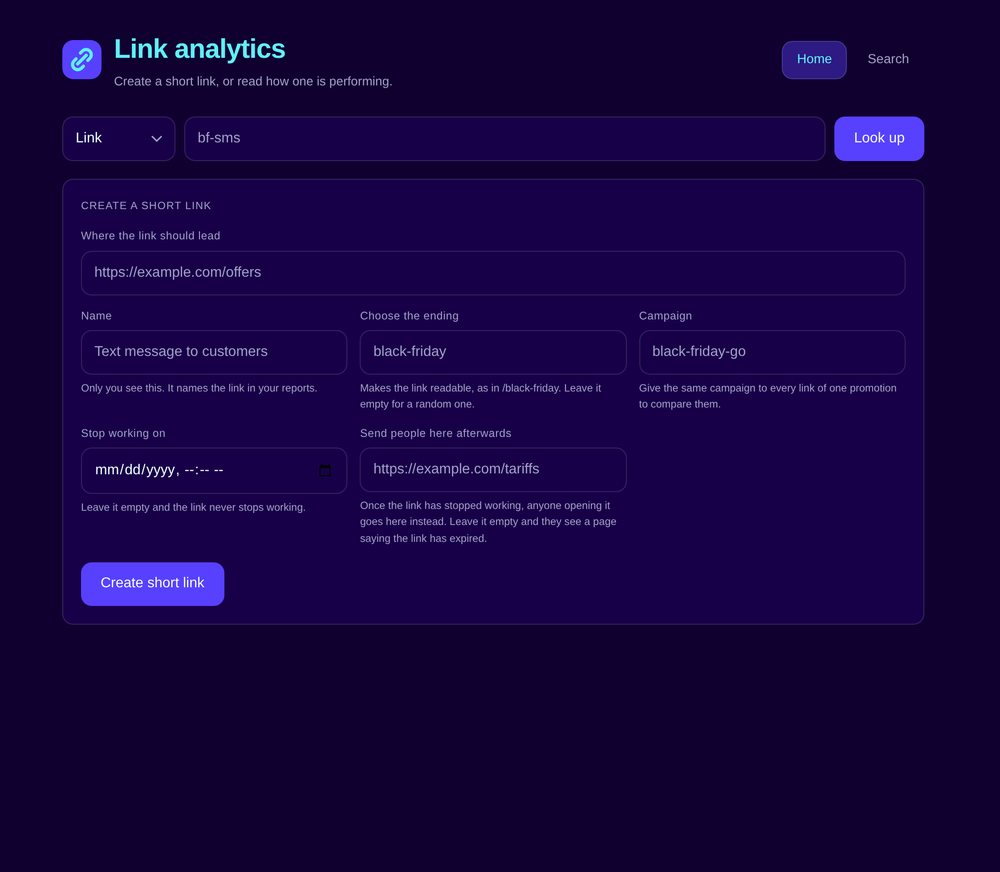
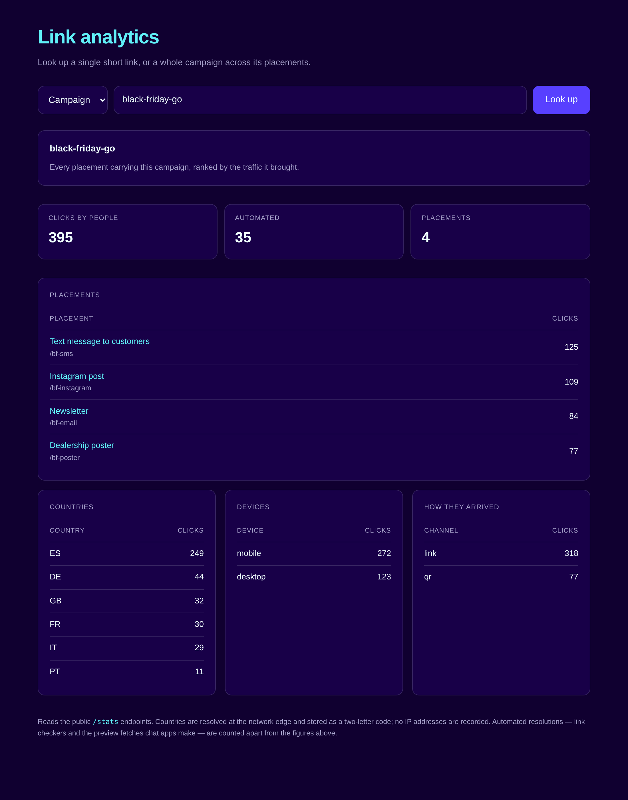
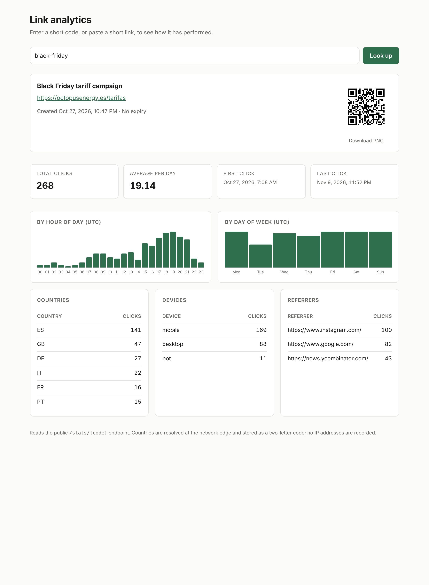

# URL shortener

A small web service that shortens URLs and reports click analytics, built with FastAPI.
Written as a hiring exercise inside a 3-hour timebox.





<details>
<summary>The per-link view</summary>



</details>

## Requirements

- Python 3.13 (3.11 or later works)
- [uv](https://docs.astral.sh/uv/) for dependency management

## Running it locally

```bash
uv sync
uv run uvicorn app.main:app --reload
```

The service listens on `http://localhost:8000`.

- `http://localhost:8000/docs` — interactive API documentation, generated from the code
- `http://localhost:8000/app` — create a short link, or look one up
- `http://localhost:8000/app?view=search` — the lookup on its own
- `http://localhost:8000/health` — is the process alive
- `http://localhost:8000/ready` — can it serve traffic

To see the page with something in it, seed a demonstration campaign first:

```bash
uv run python -m scripts.seed_demo
```

That builds four placements of one Black Friday campaign with a fortnight of clicks, each
channel decaying the way it really would: a text message is read the day it arrives, a
printed poster keeps working. Then open
`/app?campaign=black-friday-go` or `/app?code=bf-sms`.

Configuration is read from the environment, all of it optional:

| Variable | Default | Purpose |
| --- | --- | --- |
| `BASE_URL` | `http://localhost:8000` | The origin used to build the returned short URL |
| `DATABASE_PATH` | `shortener.db` | Where the SQLite file lives |
| `CODE_LENGTH` | `7` | Number of characters in a generated code |
| `DOCS_ENABLED` | `true` | Whether to serve `/docs`, `/redoc` and the OpenAPI schema |
| `RATE_LIMIT` | `30` | Links one client may create per window |
| `RATE_LIMIT_WINDOW_SECONDS` | `60` | Length of that window |

## Endpoints

| Method | Path | Behaviour |
| --- | --- | --- |
| `POST` | `/shorten` | Stores a URL. 201 on success, 400 on an invalid or unsafe URL, 409 on a taken or reserved code, 429 past the allowance, 503 if no code could be allocated |
| `GET`, `HEAD` | `/{code}` | Redirects with 302 and records the click. 404 if unknown; once expired, redirects to the fallback if one was set and answers 410 otherwise. A browser gets a page explaining what happened, a program gets JSON |
| `GET` | `/stats/{code}` | Reports the destination and the click analytics. 404 if unknown |
| `GET` | `/stats/campaign/{campaign}` | Ranks every placement carrying one campaign. 404 if no link does |
| `GET` | `/qr/{code}` | Renders the short link as a PNG QR code. 404 if unknown |
| `GET` | `/app` | The start page: create a short link, or look one up |
| `GET` | `/health` | Reports that the process is alive. Consults nothing, by design |
| `GET` | `/ready` | Reports whether this instance can serve traffic. 503 when the database is unreachable |

## Example usage

```bash
# Create a short link
curl -X POST localhost:8000/shorten \
  -H "Content-Type: application/json" \
  -d '{"url":"https://example.com","label":"home"}'
# {"code":"3TBphfZ","short_url":"http://localhost:8000/3TBphfZ","expires_at":null}

# Place a campaign: a readable code, an expiry, somewhere to send people afterwards
curl -X POST localhost:8000/shorten \
  -H "Content-Type: application/json" \
  -d '{"url":"https://example.com/offers","code":"bf-sms","label":"Text message",
       "campaign":"black-friday-go","expires_at":"2026-12-01T00:00:00Z",
       "fallback_url":"https://example.com/tariffs"}'
# {"code":"bf-sms","short_url":"http://localhost:8000/bf-sms",
#  "expires_at":"2026-12-01T00:00:00Z","fallback_url":"https://example.com/tariffs",
#  "campaign":"black-friday-go"}

# Read the campaign across its placements
curl localhost:8000/stats/campaign/black-friday-go
# {
#   "campaign": "black-friday-go",
#   "total_clicks": 395,
#   "bot_clicks": 35,
#   "links": [
#     {"code": "bf-sms", "label": "Text message to customers", "total_clicks": 125},
#     {"code": "bf-instagram", "label": "Instagram post", "total_clicks": 109},
#     {"code": "bf-email", "label": "Newsletter", "total_clicks": 84},
#     {"code": "bf-poster", "label": "Dealership poster", "total_clicks": 77}
#   ],
#   "clicks_by_channel": {"link": 318, "qr": 77},
#   "clicks_by_country": {"ES": 214, "GB": 71, ...},
#   "clicks_by_device": {"mobile": 268, "desktop": 127}
# }

# Follow one of its placements
curl -I localhost:8000/bf-sms
# HTTP/1.1 302 Found
# location: https://example.com/offers

# Read that placement on its own
curl localhost:8000/stats/bf-sms
# {
#   "code": "bf-sms",
#   "url": "https://example.com/offers",
#   "label": "Text message to customers",
#   "campaign": "black-friday-go",
#   "expires_at": "2026-12-01T00:00:00Z",
#   "is_expired": false,
#   "fallback_url": "https://example.com/tariffs",
#   "total_clicks": 125,
#   "first_clicked_at": "2026-10-27T06:08:04Z",
#   "last_clicked_at": "2026-11-09T22:52:36Z",
#   "average_clicks_per_day": 8.93,
#   "clicks_per_day": {"2026-10-27": 38, "2026-10-28": 21, ...},
#   "clicks_by_hour": {"18": 14, "19": 17, "20": 11, ...},
#   "clicks_by_weekday": {"Mon": 21, "Tue": 13, ...},
#   "clicks_by_country": {"ES": 68, "GB": 22, ...},
#   "clicks_by_device": {"mobile": 91, "desktop": 34},
#   "clicks_by_channel": {"link": 125},
#   "bot_clicks": 11,
#   "expired_clicks": 0,
#   "top_referrers": {"https://www.instagram.com/": 40, ...}
# }

# Fetch the QR code. The image encodes the link with a channel marker, so a scan is
# distinguishable from a tap in the statistics.
curl -o qr.png localhost:8000/qr/bf-poster

# Tracking parameters on the short link are carried to the destination
curl -I "localhost:8000/bf-sms?utm_source=sms"
# location: https://example.com/offers?utm_source=sms

# A taken or reserved code is refused
curl -X POST localhost:8000/shorten \
  -H "Content-Type: application/json" -d '{"url":"https://example.com","code":"docs"}'
# HTTP/1.1 409 Conflict

# So is a destination inside a private network
curl -X POST localhost:8000/shorten \
  -H "Content-Type: application/json" -d '{"url":"http://169.254.169.254/latest/meta-data/"}'
# HTTP/1.1 400 Bad Request

# An invalid URL, and an unknown code
curl -X POST localhost:8000/shorten \
  -H "Content-Type: application/json" -d '{"url":"not-a-url"}'
# HTTP/1.1 400 Bad Request
curl -I localhost:8000/zzzzzzz
# HTTP/1.1 404 Not Found
```

## Tests

```bash
uv run pytest
uv run ruff check .
uv run mypy app tests scripts
```

94 tests. They drive the application through FastAPI's test client against the in-memory
storage, so the real routes, validation and status codes are exercised without touching a
database file.

## What this service records, and what it does not

The service runs in jurisdictions with different privacy regimes, so it is built to the
strictest of them rather than to each one separately.

- **No IP addresses.** A click records the referrer, a two-letter country code and a
  device category. The country is resolved at the network edge by whatever proxy sits in
  front — `CF-IPCountry` and equivalents — so the application never receives an address.
- **No raw user agents.** The full string is a browser-fingerprinting vector. It is
  reduced at the boundary to bot, mobile, desktop or unknown, which is also the form a
  marketing question actually needs.
- **No cookies and no identifiers.** Nothing is written to the visitor's browser, so the
  service needs no consent banner under the ePrivacy Directive, and there is nothing to
  join one visit to another.
- **Rate limiting without retention.** Clients are keyed by a salted hash of their
  address, held only for the length of the window, with the salt generated per process.

**No unique-visitor count.** It would be the obvious next figure, and the usual way to get
it is to store a hash of the IP address. That is not anonymisation: with a static key, the
four billion IPv4 addresses can be hashed exhaustively in seconds, which is why the GDPR
treats a hashed address as pseudonymised personal data rather than anonymous. Counting
unique visitors honestly means either keeping personal data under a retention policy and a
lawful basis, or not counting them. This service does not count them.

What this costs: the analytics cannot answer anything about individuals or returning
visitors. That is the intended trade, not an omission.

## Design notes

- **SQLite over in-memory structures.** The brief allowed either. Click analytics that
  disappear on restart answer nothing, so the service persists; the standard library's
  `sqlite3` keeps the dependency list to FastAPI, segno and nothing else.
- **Storage behind a protocol.** Two implementations exist and both are used: SQLite runs
  the service, the in-memory one runs the tests. The abstraction earns its place rather
  than anticipating a need.
- **400 instead of 422 for an invalid URL.** FastAPI answers validation failures with 422,
  which is arguably the more correct status. The brief specifies 400, so a handler remaps
  it; following the stated contract beats being pedantic.
- **Random codes, not a counter or a hash.** A counter leaks how many links exist and
  invites enumeration; hashing the URL makes shortening the same URL twice impossible.
- **Readable custom codes.** Not asked for, but a shortener whose links go into campaigns
  and printed material needs `/black-friday`, not `/3TBphfZ`. Requested codes are checked
  against the paths the service serves itself and against codes already taken.
- **Destinations are checked.** A shortener lends its domain's credibility to whatever it
  points at, so private, loopback and link-local addresses are refused, as are links back
  to the service itself.
- **302, not 301.** A permanent redirect is cached by the browser, so the second click
  from each visitor would never reach the service and the counts would quietly run short.
- **A connection per operation.** FastAPI runs synchronous endpoints in a thread pool,
  where sharing one SQLite connection is unsafe. Opening per call is cheap and correct;
  WAL mode keeps readers from blocking the writer.
- **Liveness and readiness are separate.** `/health` says only that the process answers,
  because a liveness check decides whether to restart it and a database blip must not be
  answered by a restart. `/ready` does consult the database, so a failing dependency takes
  the instance out of rotation instead of killing it. Timings are in the access log, where
  each request records its own duration, rather than averaged inside a health check.
- **A failed resolution answers a page or a payload.** The redirect is the only route a
  person lands on directly, so a browser following an expired link gets a page that says so
  rather than raw JSON. Browsers name `text/html` in what they accept and programs do not,
  so the two are told apart without guessing. Every other route answers with a payload.
- **The page borrows the palette and nothing else.** The colours and the corner radius
  come from the stylesheet octopusenergy.es publishes, so the tool looks at home beside the
  product it serves. No logo, no wordmark, no favicon of theirs: a tool wearing someone's
  mark reads as their property. Their typeface is proprietary, and their own stylesheet
  falls back to Helvetica, which is what happens here.
- **The page is a client, not a view.** It reads the same public endpoints anyone else
  would, with no build step and no frontend dependencies, so it cannot drift from the API.
- **The form answers its own mistakes.** A browser's native validation bubble is styled by
  the browser, says what the browser decides and vanishes on the next click. The page
  reports each problem beside the field it belongs to, in that field's own wording. The
  server repeats every check regardless: the form is a convenience, not the boundary.
- **The explanations sit behind an icon.** Each field's note is one hover or keyboard focus
  away rather than printed under every input, so the form stays short enough to take in at
  a glance without leaving anything unexplained.
- **Automated traffic is counted apart, not discarded.** A figure that mixes link checkers
  and chat previews into "clicks" misleads whoever placed the link, and one that silently
  drops them hides that a link is being fetched at all. Both are reported.
- **An expired link with a fallback still redirects.** A campaign page that has ended is
  better answered with the tariff listing than with an error, and the late resolutions are
  recorded separately so the figures stay honest.
- **A campaign is a label, not an entity.** Grouping links by a string needs no second table
  and no migration, and answers the question a marketing team asks. A real product would
  promote it to a table once campaigns had properties of their own.

## Known limitations

- **Statistics are public.** Anyone holding a code can read its analytics, and a readable
  custom code is by design easy to guess. A management token issued at creation would close
  this; it was left out rather than half-built.
- **No authentication**, so anyone who can reach the service can create links.
- **Aggregations are unbounded.** A link with millions of clicks groups over its whole
  partition of the index on every call. Real traffic needs pagination or a rollup table.
- **Every distribution is in UTC.** "Clicks on Tuesday" means different things in
  different places; carrying the reader's time zone is the correct fix.
- **The redirect reads SQLite on every request**, although the mapping is immutable once
  created and caches perfectly.
- **No schema migrations.** The schema is created on first run and a database file from an
  earlier version is not upgraded.
- **Rate limiting is per process.** Several replicas would each enforce their own
  allowance; a shared store such as Redis is the way out.
- **Destination checks read the host as written.** A public domain that resolves to a
  private address is not caught.
- **Resolutions are recorded even when the answer is 410**, so an expired code can be used
  to grow the clicks table. Rate limiting covers creation, not resolution.
- **Bot detection is a heuristic.** User agents are self-reported, so a determined client
  is counted as a person and an unlisted preview service is counted as one too.

## Where this would go next

The analytics are the part of this service with the most room to grow, and the questions
a marketing team actually asks point the way:

1. **A management token per link**, issued at creation and required to read or change it.
   This is the right fix for public statistics, and it earns its keep in three situations:
   an agency placing a client's campaign should see its own numbers and not a competitor's;
   a dealership selling electric vehicles should see its links and not another dealership's;
   and whoever sent a text message to fifty thousand customers with the wrong destination
   should be able to repoint it without sending a correction — which matters more again for
   a link printed on a bill, where there is nothing to resend. It was left out rather than
   half-built.
2. **Accounts and ownership**, which is what a token is a stand-in for.
3. **Rollups.** A table of per-hour totals written as clicks arrive, so the dashboards stop
   aggregating raw rows.
4. **Time-of-day analysis in the reader's zone.** Which, for an energy retailer, is the
   interesting question: when a tariff campaign is engaged with says something about when
   people are willing to shift consumption.
5. **Caching the redirect**, the one change that most affects how this behaves under load.
6. **Sentry for errors and a `/metrics` endpoint**, which is where the correlation ids and
   structured logs already point.

## Open questions

[QUESTIONS.md](QUESTIONS.md) records the twelve decisions that depend on the business
rather than on the code, each with what it changes and the assumption taken meanwhile. The
one that most affects what this service is allowed to be: should it accept any destination,
or only an allowlist of the company's own domains?

A public shortener has to take any valid URL, which is what the brief asks for and what
this service does. An internal one should not: a shortener that accepts anything lets
someone mint a link on a trusted domain that leads to a page imitating the company, and a
text message carrying it would pass the filters a bare domain would not. The code already
refuses private and loopback destinations, but a convincing phishing page sits on a
perfectly routable host.

The answer depends on who is allowed to create links, which the brief does not say. It is
a configuration flag away either direction, and the brief invites asking — so this is the
question I would put to Enrique Tasa before choosing.
